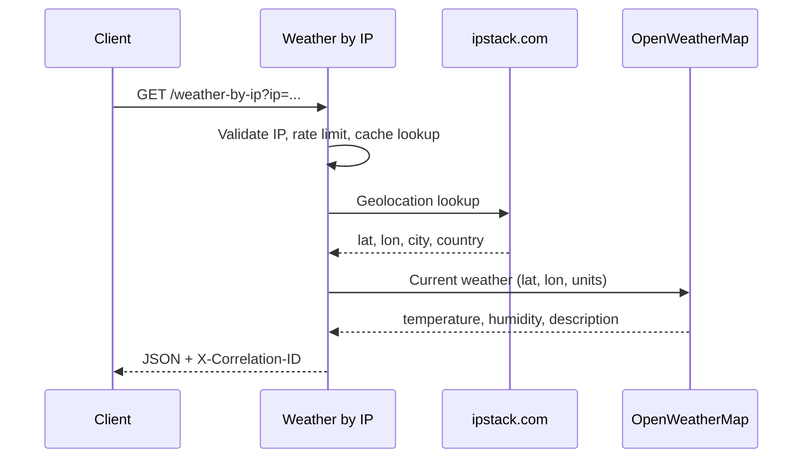

# Weather by IP API

A Spring Boot REST API that resolves a client or supplied IP address to a location (via [ipstack](https://ipstack.com/)), then returns current weather for those coordinates (via [OpenWeatherMap](https://openweathermap.org/api)). The service includes validation, caching, rate limiting, structured errors, and request correlation for easier debugging and operations.

---

## Table of Contents

- [How It Works](#how-it-works)
- [Features](#features)
- [Technologies Used](#technologies-used)
- [Getting Started](#getting-started)
  - [Prerequisites](#prerequisites)
  - [API Keys and Environment Variables](#api-keys-and-environment-variables)
  - [Building the Project](#building-the-project)
  - [Running the Application](#running-the-application)
  - [Running with Docker](#running-with-docker)
  - [Running Tests](#running-tests)
- [API Reference](#api-reference)
  - [Weather endpoint](#weather-endpoint)
  - [Actuator endpoints](#actuator-endpoints)
  - [Response and error format](#response-and-error-format)
- [Observability](#observability)
- [Project Structure](#project-structure)
- [Limitations](#limitations)

---

## How It Works



1. The client calls `GET /weather-by-ip`, optionally passing `ip` and `tempUnit`.
2. If `ip` is omitted, the server uses the request’s remote address (`getRemoteAddr()`).
3. The IP is validated (IPv4 or IPv6), then looked up on ipstack for coordinates and location names.
4. OpenWeatherMap’s current weather API is called for those coordinates.
5. Results are mapped to a small JSON payload. Successful lookups for the same IP are cached for 10 minutes.

---

## Features

- **Current weather by IP** — City, country, temperature, humidity, and short description.
- **Optional IP override** — Query a specific address instead of the caller’s IP.
- **Temperature units** — Celsius (`C`, default), Fahrenheit (`F`), or Kelvin (`K`).
- **IP validation** — Invalid or empty IPs are rejected before external calls.
- **External integrations** — OpenFeign clients for ipstack and OpenWeatherMap.
- **Caching** — Caffeine cache (`ipCache`), 10-minute TTL per IP key.
- **Rate limiting** — 5 requests per minute per client IP (Bucket4j); returns HTTP 429 with `Retry-After`.
- **Structured errors** — Consistent JSON error body with status, message, details, path, and timestamp.
- **Correlation IDs** — Each request gets a UUID in logs and the `X-Correlation-ID` response header.
- **Health and metrics** — Spring Boot Actuator endpoints for operations.

---

## Technologies Used

| Area | Stack |
|------|--------|
| Runtime | Java 17, Spring Boot 3.5.x |
| Web | Spring Web (REST) |
| HTTP clients | Spring Cloud OpenFeign |
| External APIs | ipstack, OpenWeatherMap Current Weather (`/data/2.5/weather`) |
| Cache | Spring Cache + Caffeine |
| Rate limiting | Bucket4j |
| Validation | Apache Commons Validator (IP addresses) |
| Observability | Spring Boot Actuator, Logback |
| Build | Maven (wrapper included: `./mvnw`) |
| Other | Lombok |

---

## Getting Started

### Prerequisites

- **Java 17+** — [Eclipse Temurin](https://adoptium.net/) or another JDK 17 distribution
- **Maven 3.6+** (optional if you use the Maven wrapper `./mvnw`)
- API keys from [ipstack](https://ipstack.com/product) and [OpenWeatherMap](https://openweathermap.org/api)

### API Keys and Environment Variables

The application reads credentials from the **process environment** (not from a `.env` file automatically). Set these before starting the app:

| Variable | Description |
|----------|-------------|
| `IP_STACK_API_KEY` | ipstack `access_key` |
| `WEATHER_MAP_API_KEY` | OpenWeatherMap `appid` |

**macOS / Linux:**

```bash
export IP_STACK_API_KEY="your_ipstack_access_key"
export WEATHER_MAP_API_KEY="your_openweathermap_app_id"
```

**Windows (PowerShell):**

```powershell
$env:IP_STACK_API_KEY="your_ipstack_access_key"
$env:WEATHER_MAP_API_KEY="your_openweathermap_app_id"
```

You can also define these in your IDE run configuration. If either variable is missing, the API responds with HTTP 500 and a structured error.

### Building the Project

```bash
git clone https://github.com/RanadeeshwarKamboji/weather-by-ip.git
cd weather-by-ip
./mvnw clean install
```

On Windows:

```cmd
mvnw.cmd clean install
```

### Running the Application

```bash
./mvnw spring-boot:run
```

Default base URL: **http://localhost:8080**

Example request (after keys are set):

```bash
curl -s "http://localhost:8080/weather-by-ip?ip=8.8.8.8&tempUnit=C" -D - | head
```

### Running with Docker

Build the JAR, then the image:

```bash
./mvnw clean package -DskipTests
docker build -t weather-by-ip .
docker run --rm -p 8080:8080 \
  -e IP_STACK_API_KEY="your_ipstack_access_key" \
  -e WEATHER_MAP_API_KEY="your_openweathermap_app_id" \
  weather-by-ip
```

### Running Tests

Unit tests mock external services and do not require real API keys:

```bash
./mvnw test
```

Coverage includes `WeatherService` (success and failure paths) and `Utilities` (IP validation and unit mapping).

---

## API Reference

### Weather endpoint

| Method | Path | Description |
|--------|------|-------------|
| `GET` | `/weather-by-ip` | Weather for the caller’s IP (from the HTTP connection) |
| `GET` | `/weather-by-ip?ip={address}` | Weather for the given IPv4 or IPv6 address |
| `GET` | `/weather-by-ip?ip={address}&tempUnit={C\|F\|K}` | Same, with temperature unit (default `C`) |

**Query parameters**

| Name | Required | Default | Description |
|------|----------|---------|-------------|
| `ip` | No | Client remote address | IPv4 or IPv6 address to geolocate |
| `tempUnit` | No | `C` | `C` (metric), `F` (imperial), or `K` (Kelvin / OpenWeather “standard”) |

**Success response (200)** — Response header includes `X-Correlation-ID`.

```json
{
  "ip": "2001:4860:4860::8888",
  "location": {
    "city": "Mountain View",
    "country": "United States"
  },
  "weather": {
    "temperature": "82.62°F",
    "humidity": 42,
    "description": "clear sky"
  }
}
```

**HTTP status summary**

| Status | When |
|--------|------|
| 200 | Success |
| 422 | Invalid or missing IP, or ipstack returned no usable latitude/longitude |
| 429 | Rate limit exceeded (5 requests/minute per client IP); see `Retry-After` |
| 500 | Missing `IP_STACK_API_KEY` or `WEATHER_MAP_API_KEY` |
| 502 | ipstack or OpenWeatherMap unreachable or rejected the request (e.g. bad key) |

### Actuator endpoints

Configured in `application.properties` (default port 8080):

| Path | Purpose |
|------|---------|
| `/actuator/health` | Health check (details enabled) |
| `/actuator/info` | Application info |
| `/actuator/metrics` | Metrics |
| `/actuator/httptrace` | Recent HTTP trace (if enabled for your Boot version) |

### Response and error format

Errors use a common shape (`CustomError`):

```json
{
  "status": 422,
  "error": "Incorrect Details",
  "message": "Latitude and/or Longitude value is missing",
  "details": {
    "service": "Client Request Data",
    "issue": "Provided ip address failed validation or is missing.",
    "suggestion": "Please provide valid ip address"
  },
  "path": "/weather-by-ip",
  "timestamp": "2025-07-01T21:40:28.69883491"
}
```

Rate limit responses (429) are returned by the rate-limit filter as JSON with a similar structure and a `Retry-After` header indicating when to retry.

---

## Observability

- **Logging** — Console logs include `[X-Correlation-ID]`. Per-request log files are written under `logs/request-{correlation-id}.log` (see `logback-spring.xml`; the `logs/` directory is gitignored).
- **Correlation ID** — Generated per request; echoed in response headers on success and on errors handled by `GlobalExceptionHandler`.

---

## Project Structure

```
weather-by-ip/
├── Dockerfile
├── pom.xml
├── mvnw, mvnw.cmd
├── src/main/java/com/rana/weather_by_ip/
│   ├── WeatherByIpApplication.java
│   ├── controller/          # REST entry point
│   ├── service/             # Orchestration, caching
│   ├── clients/             # OpenFeign (ipstack, OpenWeatherMap)
│   ├── configs/             # Caffeine cache
│   ├── filters/             # Rate limiting, correlation ID
│   ├── exceptions/          # Custom errors and global handler
│   ├── utilities/           # IP validation, unit mapping
│   └── model/               # DTOs (ipstack, OpenWeather, API response)
├── src/main/resources/
│   ├── application.properties
│   └── logback-spring.xml
└── src/test/java/           # WeatherServiceTests, UtilitiesTest
```

---

## Limitations

- **Client IP detection** — Without the `ip` query parameter, only `HttpServletRequest.getRemoteAddr()` is used. Behind a reverse proxy, the visible address may be the proxy unless you configure forwarded headers separately (not implemented in this project).
- **Caching** — Cache key is the IP string passed into the service; TTL is fixed at 10 minutes.
- **Rate limiting** — Applied per remote address on incoming HTTP connections, independent of the `ip` query parameter used for weather lookup.
- **Forecast scope** — Only **current** weather is returned, not multi-day forecasts.

---

## License

Refer to the repository owner for licensing; no license file is included in the project root at this time.
